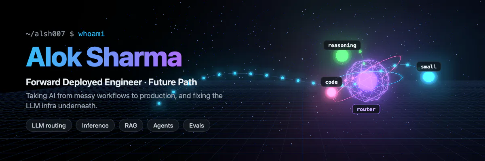

  
  
  
  
  

---

### 👨‍💻 About me

<picture>
  <source media="(prefers-color-scheme: dark)" srcset="assets/terminal-dark.svg">
  
</picture>

### 🌍 Open source

<a href="https://github.com/pulls?q=is%3Apr+is%3Amerged+author%3AAlSh007+-user%3AAlSh007">
<picture>
  <source media="(prefers-color-scheme: dark)" srcset="assets/impact-dark.svg">
  
</picture>
</a>

<b>📜 Every merged fix, with what it changed</b> (click to expand)

 

| Project | PR | What it fixed |
|---|---|---|
| [BerriAI/litellm](https://github.com/BerriAI/litellm) | [#46617](https://github.com/BerriAI/litellm/pull/46617) (co-author) | Cache the public provider and agent field endpoints, so the bundled JSON is read and parsed once per process instead of on every request |
| [vllm-project/semantic-router](https://github.com/vllm-project/semantic-router) | [#5167](https://github.com/vllm-project/semantic-router/pull/5167) | Reject a zero or negative `max_tokens_limit` or `max_n` in the request params config, so a bad limit no longer rewrites every client's `max_tokens` or `n` to zero and gets each request rejected upstream |
| [vllm-project/semantic-router](https://github.com/vllm-project/semantic-router) | [#5152](https://github.com/vllm-project/semantic-router/pull/5152) | Reject a Set answer that omits a declared label's probability, so a missing label is no longer read as zero routing evidence |
| [vllm-project/semantic-router](https://github.com/vllm-project/semantic-router) | [#4858](https://github.com/vllm-project/semantic-router/pull/4858) | Stop mirroring a request the router rejected (for example on an unresolved credential) to the shadow model |
| [vllm-project/semantic-router](https://github.com/vllm-project/semantic-router) | [#4712](https://github.com/vllm-project/semantic-router/pull/4712) | Stop tool-observability debug headers from replacing a dispatch failure with a request continue, which let a rejected request go upstream |
| [vllm-project/aibrix](https://github.com/vllm-project/aibrix) | [#3375](https://github.com/vllm-project/aibrix/pull/3375) | Make the session-affinity router's Redis read honor its 500 ms budget, so a Redis that accepts the connection and stops answering no longer holds a request for 3 s |
| [vllm-project/aibrix](https://github.com/vllm-project/aibrix) | [#3374](https://github.com/vllm-project/aibrix/pull/3374) | Keep the full UUID as the batch result id instead of its first five hex digits, which repeated in batches of a few thousand lines |
| [vllm-project/aibrix](https://github.com/vllm-project/aibrix) | [#3116](https://github.com/vllm-project/aibrix/pull/3116) | Count a panicking `SlowStartBatch` callback as a failure, so RoleSet pod create and delete batches stop hiding panics as successes |
| [vllm-project/aibrix](https://github.com/vllm-project/aibrix) | [#2975](https://github.com/vllm-project/aibrix/pull/2975) | Report a missing latency in the pending-load estimate, so routers stop treating a pod with an incomplete profile as free |
| [vllm-project/aibrix](https://github.com/vllm-project/aibrix) | [#2846](https://github.com/vllm-project/aibrix/pull/2846) | Enforce the prefix-hash table's `maxContexts` cap and evict expired pods ([write-up: what the review taught me about activating dead code](writeups/aibrix-prefix-cache-eviction.md)) |
| [llm-d/llm-d](https://github.com/llm-d/llm-d) | [#2410](https://github.com/llm-d/llm-d/pull/2410) | Align the modelexpress-p2p guide's `PROVIDER_NAME` default with optimized-baseline, so a default install no longer applies GKE-only router resources on a non-GKE cluster |
| [theopenco/llmgateway](https://github.com/theopenco/llmgateway) | [#4673](https://github.com/theopenco/llmgateway/pull/4673) | Send the array text content of a Bedrock assistant tool-call message as text blocks |
| [theopenco/llmgateway](https://github.com/theopenco/llmgateway) | [#4672](https://github.com/theopenco/llmgateway/pull/4672) | Keep Anthropic `output_config.effort` when a `json_schema` response_format is used, so the effort setting is no longer dropped from the request body |
| [theopenco/llmgateway](https://github.com/theopenco/llmgateway) | [#4259](https://github.com/theopenco/llmgateway/pull/4259) | Re-pick the auto reasoning effort for fallback providers |
| [theopenco/llmgateway](https://github.com/theopenco/llmgateway) | [#3960](https://github.com/theopenco/llmgateway/pull/3960) | Clamp auto reasoning effort in the gateway |
| [tabloy/keygate](https://github.com/tabloy/keygate) | [#135](https://github.com/tabloy/keygate/pull/135) | Reject a webhook URL that names no host, so a webhook that could never be delivered is no longer saved |
| [tabloy/keygate](https://github.com/tabloy/keygate) | [#134](https://github.com/tabloy/keygate/pull/134) | Print expiry reminder and update-period dates in UTC, so a server not on UTC no longer names the wrong day |
| [tabloy/keygate](https://github.com/tabloy/keygate) | [#132](https://github.com/tabloy/keygate/pull/132) | Decide `IsLocalhostURL` from the parsed host instead of a substring match |
| [tabloy/keygate](https://github.com/tabloy/keygate) | [#131](https://github.com/tabloy/keygate/pull/131) | Claim an idempotency key afresh once its 24 h TTL has passed, instead of replaying the stale cached response |
| [theagentrouter/agent-router](https://github.com/theagentrouter/agent-router) | [#2749](https://github.com/theagentrouter/agent-router/pull/2749) | Accept `reasoning_effort: high` for Gemini 3 Pro models, and map `medium` to the right thinking level per model |
| [JuliusBrussee/caveman](https://github.com/JuliusBrussee/caveman) | [`e186906`](https://github.com/JuliusBrussee/caveman/commit/e186906a0c41d03a638fa4cb11b105359d4d8ed9), [`37f4b6d`](https://github.com/JuliusBrussee/caveman/commit/37f4b6d723d1d951fde472887a9b04ca84789e83), [`4f7e811`](https://github.com/JuliusBrussee/caveman/commit/4f7e8117332b557eb28c6808387dcb0432c51b7a) (adopted in [#1315](https://github.com/JuliusBrussee/caveman/pull/1315)), [`73a0717`](https://github.com/JuliusBrussee/caveman/commit/73a0717222a23c0c7834f6552fe4df69a8f31cd9), [`072dc20`](https://github.com/JuliusBrussee/caveman/commit/072dc201708bc9c77ce59c0c4a01dfd4208b1b0a) (adopted in [#1475](https://github.com/JuliusBrussee/caveman/pull/1475)) | Stop `uninstall` deleting a `settings.json.bak` it did not create, read the schema of Anthropic `input_schema` tools in `shrink`, keep integers above 2^53 off the numeric range track so elision markers stay correct, keep the percent-encoded slash of a Bedrock ARN model id upstream in the proxy, and stop the middleware marking a response over the limit at a quarter of it |

📝 **Deeper dive:** [Fixing code that was never called: wiring up eviction in AIBrix's prefix-cache index](writeups/aibrix-prefix-cache-eviction.md)

### 🧪 Things I've built

<table>
  <tr>
    <td width="50%" valign="top">
      <h4><a href="https://github.com/AlSh007/forge-ai">⚒️ forge-ai</a></h4>
      Autonomous coding agent platform: six specialised agents turn a task and a repo URL into a plan, code and an optional PR, with a live pipeline dashboard.  
       
    </td>
    <td width="50%" valign="top">
      <h4><a href="https://github.com/AlSh007/issue2pr">🔁 issue2pr</a></h4>
      Agent that turns a GitHub issue into a pull request: plans, codes and reviews it, with human approval and a web view of the workflow.  
        
    </td>
  </tr>
  <tr>
    <td valign="top">
      <h4><a href="https://github.com/AlSh007/prereview_cli">🔍 prereview_cli</a></h4>
      Local-first CLI that reviews your git changes before you commit or open a PR, with optional AI and architecture review.  
       
    </td>
    <td valign="top">
      <h4><a href="https://github.com/AlSh007/pystep">🐍 pystep</a></h4>
      Step-by-step Python execution visualiser: watch the stack and heap change as your code runs.  
       
    </td>
  </tr>
  <tr>
    <td valign="top">
      <h4><a href="https://github.com/AlSh007/leetpush">🚀 leetpush</a></h4>
      Chrome extension that pushes accepted LeetCode solutions to GitHub, with optional AI complexity analysis and progressive hints.  
      
    </td>
    <td valign="top">
      <h4><a href="https://github.com/AlSh007/leetcode-solutions">🧩 leetcode-solutions</a></h4>
      My LeetCode solutions in Python, added regularly.  
      
    </td>
  </tr>
</table>

### 🛠️ Tech stack

   
   
  

  
  
  
  
  
  

### 📊 GitHub activity

<picture>
  <source media="(prefers-color-scheme: dark)" srcset="https://streak-stats.demolab.com/?user=alsh007&theme=github-dark-blue&hide_border=true&background=0d1117">
  
</picture>

<picture>
  <source media="(prefers-color-scheme: dark)" srcset="https://github-readme-activity-graph.vercel.app/graph?username=alsh007&bg_color=0d1117&color=8b949e&line=36bcf7&point=a371f7&area=true&area_color=36bcf7&hide_border=true">
  
</picture>

  

